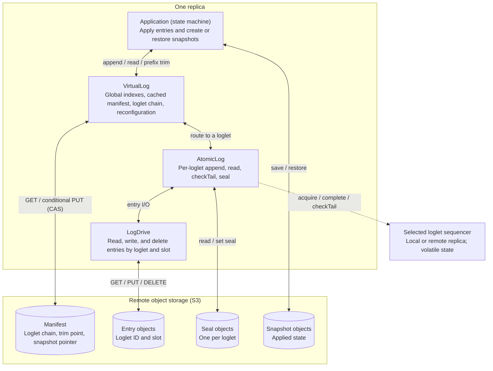
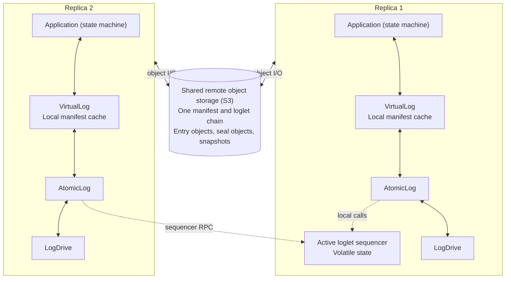
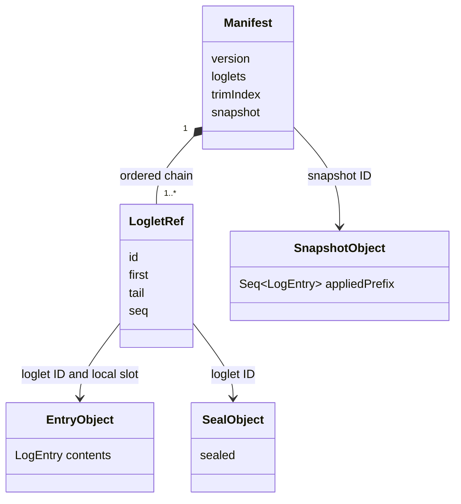
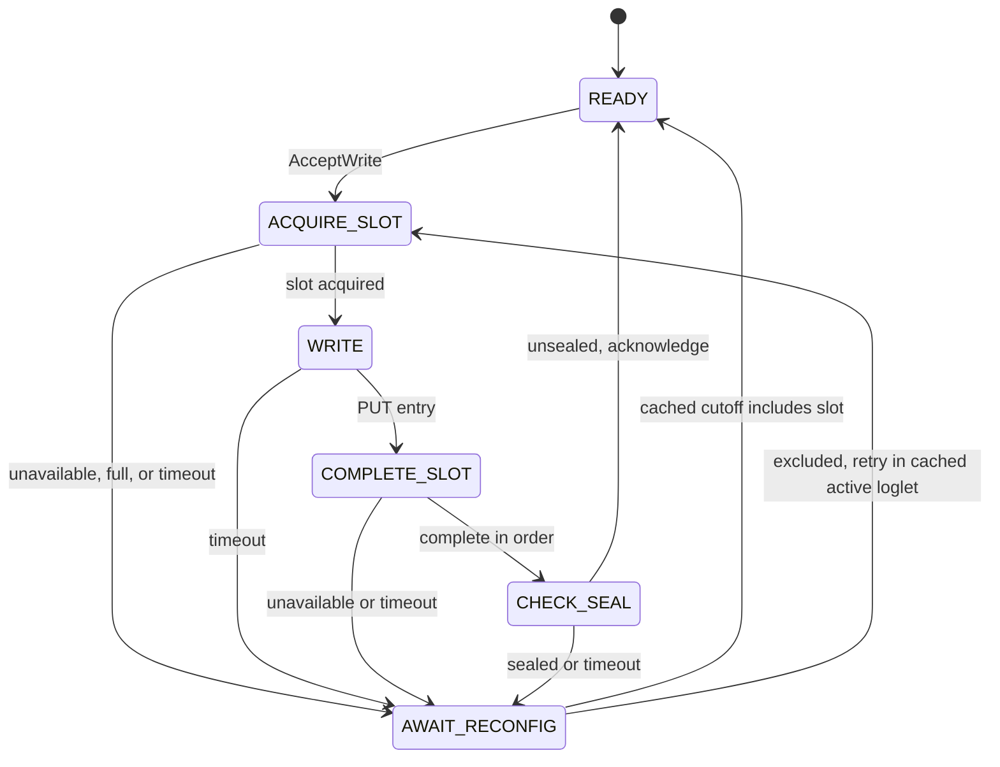
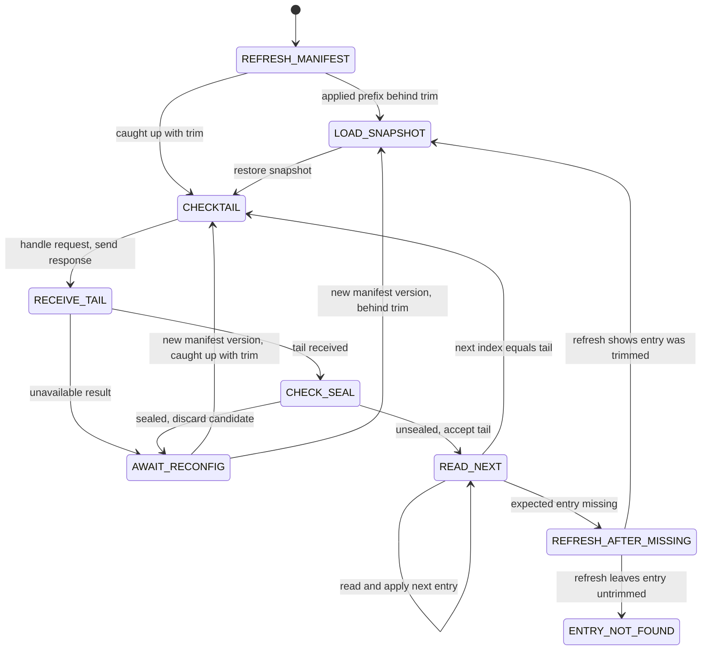
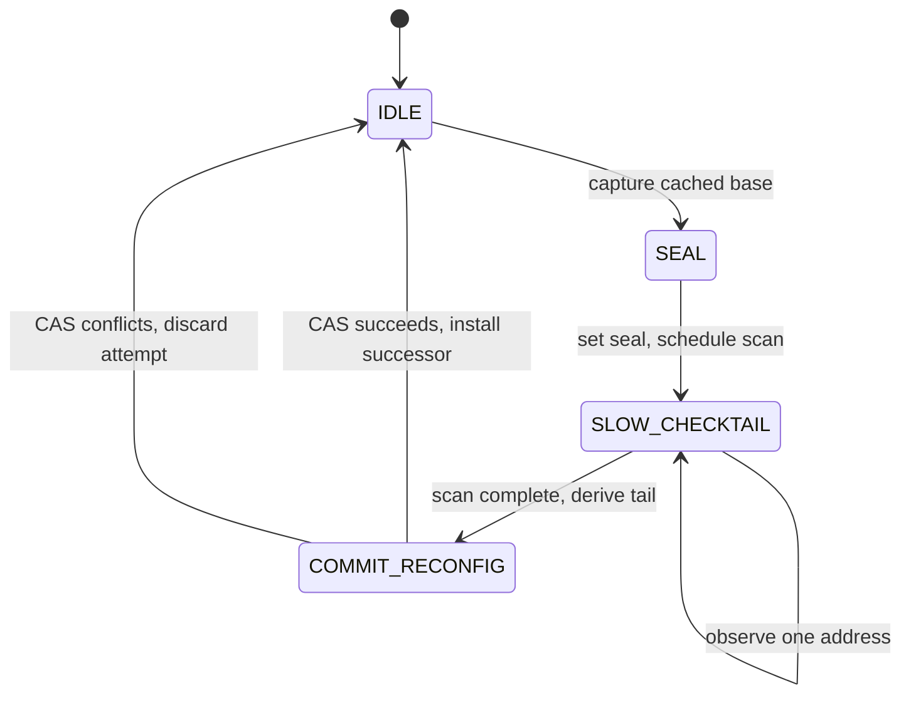
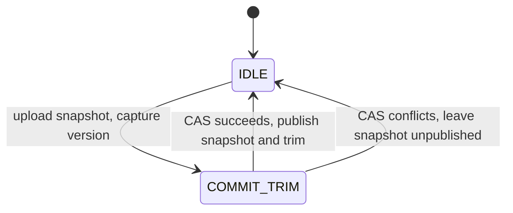

# Conflux

[Conflux](spec/Conflux.tla) is a multi-master shared log design based on [Virtual Consensus in Delos](https://www.usenix.org/system/files/osdi20-balakrishnan.pdf), using the [LogDrive](https://www.usenix.org/system/files/osdi26-vickers.pdf) design backed by S3. An ordered chain of **loglets** forms one virtual log. A soft-state sequencer orders appends within each loglet; durable seal objects and a manifest protected by CAS allow replicas to replace that sequencer without losing committed entries.

Each replica runs four independently scheduled tasks: append, read/apply, reconfiguration, and snapshot/GC. Tasks share a cached manifest. S3 holds the only durable state; a replica crash loses its local tasks, cache, and sequencer state.

## Application / Virtual Consensus / LogDrive abstractions

Each replica has an Application state machine over a VirtualLog. VirtualLog maps global indexes onto a chain of loglets and manages reconfiguration through the manifest. AtomicLog provides the per-loglet append, read, tail, and seal operations, using a sequencer to order appends and LogDrive to access entries by slot. 

> The TLA+ spec does not directly model these abstractions as modular components, but does faithfully model the logic carried out across these abstractions.

The diagram below shows one replica and the remote objects it accesses. The application creates and restores snapshots; VirtualLog publishes their pointers and trim points through manifest CAS. The loglet's sequencer may be local or on another replica. Its state is volatile; object storage holds all durable state.

With two replicas, each runs the same stack and maintains its own applied state and cached manifest. Both access the same virtual log in object storage. In this example, replica 1 hosts the active loglet's sequencer; replica 2 contacts it for slot allocation, completion, and fast tail checks. Either replica can append or initiate reconfiguration, which can select a different sequencer for the next loglet. The storage arrows represent each replica's entry, seal, manifest, and snapshot I/O.

## Specification Data model

The manifest describes the loglet chain and the published snapshot. Log entries and seal bits are separate objects.

A loglet ref identifies its sequencer, the global position of its first entry, and its final local tail when closed. The last loglet is active. Its manifest tail is zero until reconfiguration publishes a tail.

Slots (local loglet addresses) and global indexes start at one. **All tails are exclusive.** A loglet starting at global index 10 with local tail 4 contributes entries at global indexes 10–12; its successor starts at 13. The empty global log has tail 1. The trim index identifies the last entry covered by the published snapshot.

### LogEntry contents

One S3 object stores one Conflux LogEntry, whose contents are opaque to the shared log protocol. An entry can contain a command, or sequence of commands, but those commands are not modeled in this generic Conflux spec. For example, Conflux entry 7 could contain items 100–102 of projected log P, while entry 8 contains items 1–2 of log Q. The application interprets those contents and their separate addresses.

Conflux orders and trims the containing LogEntries. The modeled application retains their sequence as an abstraction of applying them. [Chroma's Wal3](../chroma/Wal3_notes.md#wal-metadata-and-data) explicitly models a similar distinction between fragment sequence numbers and positions of items inside fragments.

## Manifest access

All tasks depend on a local, cached copy of the manifest. In this spec, for simplicity, the Apply task handles cached manifest refresh, other tasks that depend on a refreshed manifest block until the Apply task refreshes it. Reconfiguration and trim publication (GC) conditionally replace the manifest only if its version on S3 still matches the cached version, captured when the operation began.

A successful CAS advances the manifest version (etag). Concurrent reconfiguration and GC can invalidate each other's attempts, and an operation started from stale metadata can fail its CAS.

## Appending

The normal append path is:

1. Accept a write as a LogEntry to be appended to the active loglet (of the cached manifest).
2. Acquire the next free slot from the sequencer.
3. PUT the entry object (to S3) at that slot address.
4. Complete the sequencer slot, which is only allowed when all preceding slots have completed.
5. Read the loglet's seal bit. An unset bit permits acknowledgment.

### An ambiguous append must be resolved before retrying

A timeout or an observed seal does not establish whether the append failed. The entry might already be durable and retained by the reconfiguration task that sealed the loglet.

`CheckManifest` waits until Apply refreshes the cache with the loglet's final tail. If `0 < slot < tail`, the append succeeded and can be acknowledged. Otherwise it retries in the new active loglet. Thus this retry path avoids introducing duplicates.

## Reading and applying

Apply task, on starting, first refreshes the manifest and loads the published snapshot if its application state trails the trim point. It then obtains a tail through a two-step sequencer RPC:

1. `FastCheckTail` sends and handles the request, producing a response with the observed local tail or an unavailable result.
2. `FastCheckTailResponse` receives that saved response and translates a successful result to a global candidate tail.

The response can be delayed while appends, crashes, or reconfiguration proceed. Delivery uses the saved result. `CheckSealBeforeRead` then reads the seal bit: an unset bit accepts the candidate; a set bit discards it and waits for reconfiguration.

Apply reads entries strictly below the accepted tail, using cached loglet descriptors to locate them. Reaching the tail returns directly to checkTail, including when no new entries are available. Manifest refresh is reserved for startup or restart, waiting for reconfiguration, and diagnosing a missing entry. A response overtaken by later appends can still describe a valid committed prefix.

**A missing entry requires a metadata refresh before diagnosing loss.** Another replica may have snapshotted and collected it since the reader last refreshed. If the new trim point covers the missing entry, Apply restores the snapshot; otherwise the expected committed data is missing and Apply enters `ENTRY_NOT_FOUND` (which cannot happen, but is modeled).

## Reconfiguration and slow checkTail

A full loglet, an unavailable sequencer, or an ambiguous append motivates reconfiguration. The spec also allows an idle reconfiguration task to start proactively, subject to the configured loglet limit.

1. Capture the active loglet and manifest version from the cache.
2. Set the loglet's durable seal bit (on S3).
3. Scan the untrimmed addresses, one at a time in arbitrary order, recording which contain entries.
4. Choose the first missing position in those observations as the exclusive tail.
5. CAS the manifest to close the old loglet and append a successor starting at that tail's global position. Success also initializes the new loglet and sequencer in this model. A conflict ends the attempt without publishing its tail.

**Sealing does not stop delayed PUTs.** Writers and GC can interleave with the scan, so slow checkTail is not an atomic storage snapshot. Objects may appear after their addresses were checked. The published tail determines which entries belong to the closed loglet; objects at or beyond it remain excluded even if they exist in S3. The weak seal prevents delayed puts from being committed.

This is why both append acknowledgment and the fast read path check the seal after consulting the sequencer. Once sealing is observed, they wait for the recovery decision instead of relying on the old sequencer's view.

## Snapshots and prefix trimming

GC separates snapshot upload, publication, and object deletion:

1. `StartPrefixTrim` uploads the replica's applied prefix as a snapshot and captures the cached manifest version.
2. `CommitPrefixTrim` attempts to publish the snapshot and its last included index using manifest CAS. Success advances the trim point; conflict leaves the uploaded snapshot unpublished. Both outcomes return to `IDLE`.
3. Independently, `CollectEntry` deletes objects authorized by the collecting replica's cached trim point.

Publication alone does not let a replica use the new trim point for deletion: it must first refresh its cache. With Apply owning refreshes in this model, collection under a newly published trim waits for a startup or recovery refresh. An older cached trim point remains safe because published trim points never move backward.

## Commitment, acknowledgment, and failures

A reader can accept a completed prefix and apply an entry before its appender acknowledges it. Recovery can also retain a durable entry whose appender never completed or acknowledged the operation. Commitment and acknowledgment therefore cannot be treated as the same event.

The verification history records committed prefixes observed by either append completion or a read, whichever records them first. It checks that subsequent recovery, application, snapshots, and acknowledgments agree with that history. It does not require the application to apply an entry before the append can finish.

On a replica crash, durable objects survive while its local state and sequencer are lost. Apply restarts by refreshing the manifest and restoring/replaying durable state. Reconfiguration creates a new loglet with its own sequencer. The model discards the crashed replica's pending append; client retries across crashes are not modeled.

The safety checks cover log continuity, preservation of committed entries, consistent application and snapshots, valid read bounds, and duplicate avoidance for those distinct requests. The spec does not assert real-time tail freshness or prove linearizability.
