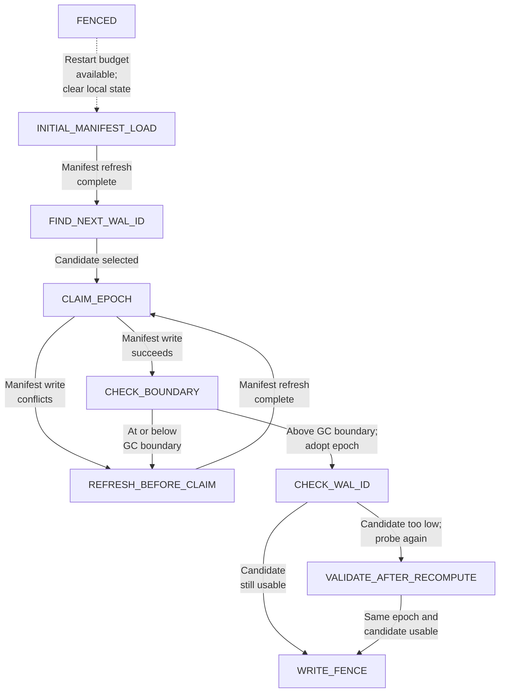
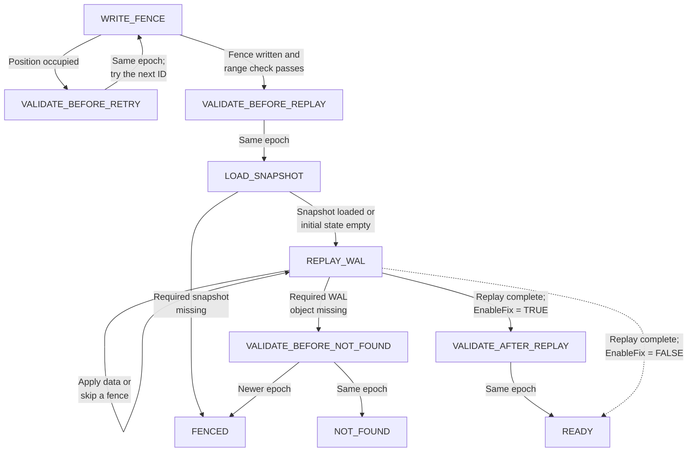

# SlateDB WAL protocol

This specification models SlateDB's single-writer WAL and fencing protocol. It replaces LSM flushes with snapshots of a state machine. The machine state is the sequence of successfully written values. Here, `snapshot` means a snapshot of that state, not a SlateDB manifest snapshot.

The model checks that:

1. The machine data ov every writer that has finished initialization (READY) is a prefix of the successful write history.
2. A ready writer with the latest manifest contains the complete history.
3. The latest manifest, its snapshot, and the retained WAL can reconstruct all successful writes.
4. Claimed writer epochs are unique, and writers and collectors never reach error states.

## Writer initialization

A writer claims an epoch, places a fence record in the WAL, and rebuilds its state before accepting writes in the `READY` state. Other writers and garbage collectors can run between any of these steps.

Every manifest refresh reads the latest manifest, then checks its ID against the manifest GC boundary in a separate step. A manifest at or below that boundary is rejected and the read is retried. The refresh phases are `REFRESH_LOAD`, `REFRESH_CHECK`, and `REFRESH_DONE`; a failed check returns directly to `REFRESH_LOAD`. The writer stays in its current initialization state until the refresh completes.

After claiming an epoch, each epoch-validation state also compares the checked manifest's epoch with the writer's own epoch. A newer epoch means another writer has taken over, so the writer enters `FENCED`. A lower epoch is an `ILLEGAL_STATE`. Passing a boundary check alone does not establish epoch ownership. The diagrams show progress and retries; these shared epoch-error exits also apply at every validation state.

Initialization begins with loading a manifest and claiming an epoch:



In `INITIAL_MANIFEST_LOAD`, the writer obtains a checked manifest. `FIND_NEXT_WAL_ID` then probes the WAL for a candidate fence position, starting at the first WAL not covered by the manifest. Probing is not atomic: concurrent writes, flushes, and GC can leave the candidate behind the current WAL tip.

In `CLAIM_EPOCH`, the writer attempts to create the next numbered manifest with a higher epoch, using put-if-absent. A successful write must also pass `CHECK_BOUNDARY` before the writer adopts that epoch. A write conflict or failed boundary check sends it to `REFRESH_BEFORE_CLAIM`, which loads a manifest, checks it against the boundary and retries the claim. These retries retain the candidate WAL ID.

An older writer may have flushed more data between discovery and the successful claim. In `CHECK_WAL_ID`, the new writer checks whether its candidate precedes the replay start in its manifest. If so, it probes again, then enters `VALIDATE_AFTER_RECOMPUTE` to refresh the manifest and verify its epoch and candidate. Otherwise, it proceeds directly to `WRITE_FENCE`. A candidate that remains below the replay start after validation yields `ILLEGAL_STATE`.

The writer then places its fence and recovers the database:



`WRITE_FENCE` uses put-if-absent to create an empty WAL object. If the position is occupied, `VALIDATE_BEFORE_RETRY` refreshes the manifest. An unchanged epoch permits another attempt at the next ID; a newer epoch fences the writer. After a successful fence write, the fence ID must be at or beyond the replay start in the writer's manifest. Failure yields `ILLEGAL_STATE`. The writer then refreshes and checks its epoch in `VALIDATE_BEFORE_REPLAY`.

`LOAD_SNAPSHOT` restores the state covered by the checked manifest, or starts with empty state if there is no prior snapshot. A required snapshot that has disappeared fences the writer. `REPLAY_WAL` then reads from the manifest's replay start through the writer's own fence, inclusive. It applies data objects and skips fence objects. This recovery range is fixed; later WAL appends do not extend it. Already-replayed data can be flushed concurrently, as described in the next section.

Note: `firstReplayWalId` is the first WAL ID to replay. It equals SlateDB's `replay_after_wal_id + 1`. A snapshot at ID `n` contains the applied history through WAL ID `n`; its manifest sets
`firstReplayWalId` to `n + 1`.

A missing WAL object sends the writer to `VALIDATE_BEFORE_NOT_FOUND`. It refreshes the manifest to distinguish a takeover from an unexpected gap. A newer epoch fences it; an unchanged epoch leads to `NOT_FOUND`, which violates the safety checks. It does not silently skip the gap.

With `EnableFix = TRUE`, completing replay leads to `VALIDATE_AFTER_REPLAY`. This final refresh checks for a takeover during recovery before allowing the writer to enter `READY`. The earlier check cannot rule out a takeover during replay. With `EnableFix = FALSE`, replay goes directly to `READY`, enabling the known late-fence counterexample (documented here: https://github.com/Vanlightly/s3-wal-collection/issues/2).

A fenced writer stops that initialization attempt. If the shared restart budget permits, it can clear its local state and return to `INITIAL_MANIFEST_LOAD` to begin a fresh attempt to take control. Restart preserves the durable objects. `NOT_FOUND` and `ILLEGAL_STATE` are error states, not restart paths.

## Flushes during replay and normal writes

`WriteSnapshot` is enabled in both `REPLAY_WAL` and `READY`. During replay, it snapshots the applied prefix through `wReplayId - 1`. In `READY`, it uses `wNextWalId - 1`.

`wSnapshotId` records a pending snapshot. Replay or appends can continue before `CommitSnapshot` publishes it. The commit uses the captured snapshot ID, not the writer's later cursor. Only one snapshot per writer can await commit. Flushes do not reset the replay cursor or its fixed end.

This permits the important interleaving:

```text
replay a prefix -> write its snapshot -> replay more entries
    -> commit the earlier snapshot -> GC deletes covered WALs -> continue replay
```

A manifest write conflict fences the writer. This shortcut depends on excluding compactor manifest writes. SlateDB instead refreshes and retries, and checks the writer epoch on refresh. With only writer claims and flushes, a conflicting write implies another writer has taken over.

`CommitSnapshot` deliberately omits the boundary check (which the impl does do) after its manifest PUT. SlateDB performs that check for every sequenced write. The omission allows additional stale-writer behavior in this safety model; checked readers still reject any manifest at or below the boundary.

## Garbage collection

Each collector selects one task and loads a checked manifest. A manifest collector then reads the boundary, finds the highest manifest ID below its loaded manifest, and advances the boundary with CAS. A stale CAS restarts the collector. It deletes manifests at or below the saved boundary. The implementation's manifest collector uses a listing rather than this checked manifest read.

A WAL collector deletes only DATA objects with IDs strictly below `firstReplayWalId - 1`, matching SlateDB's strict comparison with `replay_after_wal_id`. It retains that boundary object and every fence. It does not discover or separately protect the last WAL ID. It may also delete state-machine snapshots older than the snapshot referenced by its loaded manifest.

Collectors stop in `DELETE` or `DONE`. `DELETE` permits further eligible deletions but does not start another collection cycle. Use multiple collectors to explore separate collection cycles and concurrent manifest and WAL collection.

## Scope and liveness

Compactors, checkpoints, minimum object ages, expected epochs, WAL-disabled mode, tailing readers, and fence GC are out of scope. Retaining fences matches SlateDB's default fence-GC dry run. Ignoring minimum ages and checkpoints makes ordinary WAL GC more aggressive. WAL PUTs have clean success or conflict outcomes; ambiguous responses and their verification are abstracted away.

Each writer has at most one WAL PUT in progress. DATA objects are nonempty, and fence objects carry no values. The initial manifest uses key and ID 1. `TypeOK` includes error states; `ValidWriters` and `ValidGarbageCollectors` require them to remain unreachable.

Fenced writers can restart up to the shared `MaxWriterRestarts` limit. Restart clears the writer's local state and returns it to `INITIAL_MANIFEST_LOAD`. Before claiming an epoch, a writer can refresh and retry without spending that restart budget. With `LivenessSpec` and symmetry disabled, the temporal properties require all values to be written, writers to settle in `READY` or `FENCED`, and collectors to settle in `DELETE` or `DONE`.

## Model checking

The following model has 49B unique states (2h 37min on a Thradripper 9980X with 40 workers):

```
Writers = {w1, w2, w3}
GarbageCollectors = {gc1}
Values = {v1, v2}
MaxWriterRestarts = 1
EnableFix = TRUE
```

The simpler, original spec, now named `SlateDBWAL_TLAPSBENCHBUG` has a smaller state space (12B) for the same model parameters.